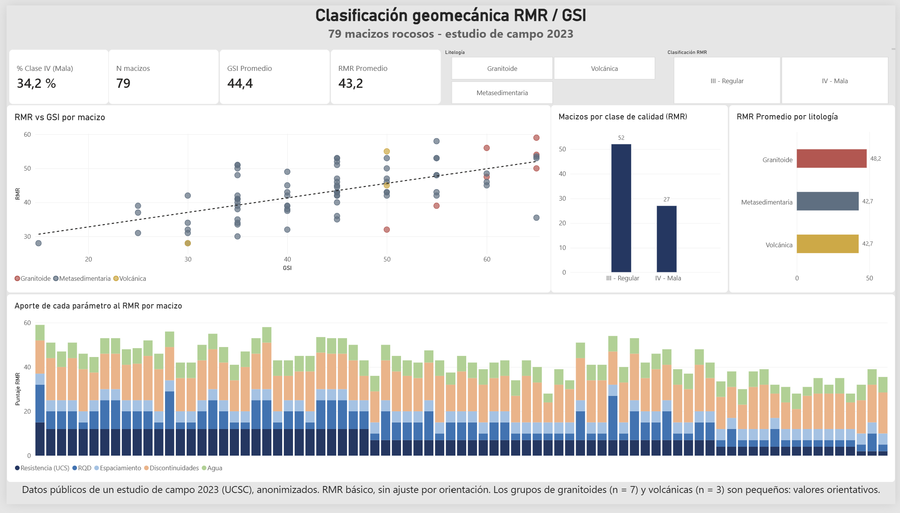

# Clasificación geomecánica RMR / GSI

Análisis y dashboard de **79 macizos rocosos** con Python y Power BI: control de calidad de los datos, verificación del cálculo del RMR y exploración de su relación con el GSI y la calidad de roca.



## Datos

- **Fuente:** *Rock mass quality and structural geology observations in Prince William Sound, Alaska (2023)*, U.S. Geological Survey (USGS) data release — https://doi.org/10.5066/P1M7ZICQ
- **Tipo:** datos públicos de terceros. No corresponden a proyectos propios ni de mi empleador.
- **Alcance:** 79 macizos con puntajes de RMR, GSI, UCS, RQD y Q.
- **Anonimización:** se eliminaron nombres de sitio, coordenadas, fechas, ubicaciones y descripciones textuales; los macizos se renombraron `Macizo_01 … Macizo_79`.
- **Licencia de los datos:** dominio público ([Public Domain Label 1.0](http://www.usa.gov/publicdomain/label/1.0/)), según el catálogo de datos del USGS. `data/macizos.xlsx` es una versión reducida y anonimizada de esos datos.
- **Cita:** Belair, G.M., Lahusen, S.R., Avdievitch, N.N., Ellison, S.M., Rosenkrans, H.S., Einbund, M.M., Amaral, T.O., Miles, C.P., and Corbett, S., 2025, Rock mass quality and structural geology observations in Prince William Sound, Alaska (2023): U.S. Geological Survey data release, https://doi.org/10.5066/P1M7ZICQ.
- **Aclaración:** este análisis es independiente y no está respaldado ni avalado por el USGS.

## Qué hace el proyecto

1. **QA/QC:** duplicados, vacíos y rangos válidos de cada puntaje (límites del RMR de Bieniawski, 1989).
2. **Verificación del RMR:** se recalcula como suma de los 5 puntajes (UCS, RQD, espaciamiento, condición de discontinuidades y agua) y se compara con el valor de la fuente.
3. **Clasificación de calidad:** clases de Bieniawski (I >80, II >60, III >40, IV >20, V ≤20).
4. **Exploración:** estadística descriptiva, correlación RMR–GSI (Pearson y Spearman) y gráficos.
5. **Dashboard en Power BI** con tarjetas, segmentadores y cuatro visuales.

## Resultados principales

- **Verificación:** el RMR recalculado coincide con el de la fuente en los 79 macizos, sin valores fuera de rango ni vacíos en las columnas clave.
- **Clases:** 52 macizos en clase III (Regular) y 27 en clase IV (Mala). No hay macizos en las clases I, II ni V.
- **Relación RMR–GSI:** correlación de Pearson 0,63 (R² ≈ 0,39). Es moderada: el GSI explica solo una parte de la variación del RMR.
- **Promedios:** RMR 43,2 y GSI 44,4.

## Estructura

```
├── data/        macizos.xlsx
├── notebooks/   analisis.ipynb
├── output/      gráficos y macizos_procesados.csv
├── docs/        capturas del dashboard
└── Dashboard_Geomecanica.pbix
```

## Cómo ejecutarlo

Requiere Python 3.13 (las librerías científicas aún pueden no tener versiones compiladas para Python más recientes).

```bash
python -m venv venv
venv\Scripts\activate          # Windows
python -m pip install pandas numpy matplotlib seaborn scipy openpyxl jupyter
```

Abrir `notebooks/analisis.ipynb` con el kernel del entorno `venv` y ejecutar todas las celdas. El dashboard se abre con Power BI Desktop (solo Windows).

## Limitaciones

- Datos de terceros: es un análisis exploratorio y de control de calidad, no una evaluación geotécnica de diseño.
- **RMR básico**, sin ajuste por orientación de discontinuidades. El SMR usa el ajuste informado por la fuente.
- Granitoides (n = 7) y rocas volcánicas (n = 3): muy pocos casos, sus promedios son solo orientativos.
- El espaciamiento vale lo mismo en todos los macizos (5) y no aporta variación.
- La litología es una clasificación simplificada, hecha por palabras clave de la descripción original: *Metasedimentaria* agrupa wacka, lutita y pizarra; *Volcánica*, rocas volcánicas y básicas.
- Las correlaciones describen la muestra y no implican causalidad.
- No hay datos de volumen explotable.

## Herramientas

Python (pandas, NumPy, Matplotlib, seaborn, SciPy), Power BI Desktop (DAX), Excel.

## Autor

Felipe Álvarez Flores — Geólogo · https://www.linkedin.com/in/felipe-alvarez-flores-72906131a/
